# Serial Modem Host Application

## Overview
Host-side firmware for Nordic Smart Modem modules. This repository is built on the nRF Connect SDK (NCS) and follows the modular zbus + SMF architecture used by the Asset Tracker Template.

The application runs on the nRF54L15 host of the nRF93M1 DK, with cellular connectivity provided over the on-board nRF93M1 Serial Modem via PPP. The host terminates DTLS and CoAP itself; PPP simply carries IP traffic between the host's network stack and the modem's cellular radio. The modem's own on-board AT-based cloud client is not used here. The application targets the non-secure (TF-M) build and stores the host's TLS credentials in Protected Storage. Telemetry, location, and FOTA all go to nRF Cloud over CoAP. Location fixes still pull raw cell and Wi-Fi scan data from the modem using AT commands, but the actual cloud request is made host-side over CoAP. Diagnostics are sent to your nRF Cloud project.

There are three variants of the application:

1. Serial Modem Host Application for the nRF91M1 using PPP+CMUX (nRF9151-DK with nRF54L15-DK or nRF54LM20-DK)
2. Serial Modem Host Application for the nRF93M1 using PPP+CMUX (nRF93M1 + nRF54L15 on the nRF93M1-DK)
3. Serial Modem Host Application for the nRF93M1 using AT commands (nRF93M1 + nRF54L15 on the nRF93M1-DK)

[Serial Modem Host Applications](https://github.com/nrfconnect/ncs-serial-modem-host-applications/)

For this session we will work with variant **2**, the `93m1_ppp` build: the PPP+CMUX Serial Modem Host Application for the [nRF93M1](https://www.nordicsemi.com/Products/nRF93-Series) Smart Modem.

### Procedure overview
This chapter walks through the full provisioning flow for the Serial Modem Host Application, in order:
1. Connect the nRF93M1-DK and identify the COM ports
2. Install the provisioning tools (nRF Cloud Utils)
3. Flash the Serial Modem application to the nRF54L15 host
4. Create the Hardware Version in nRF Cloud
5. Get the device ID
6. Create a self-signed CA certificate
7. Install the device credentials
8. Onboard the device to nRF Cloud
9. View the device in nRF Cloud
10. Insert the SIM card and check the observability data (Memfault)
11. Update the application firmware over FOTA

> **Prerequisite:** this chapter assumes you already have an nRF Cloud account and team, as set up in the earlier onboarding chapter.

## Step 1 — Connect the DK and identify the COM ports
Connect the nRF93M1 DK to your computer using USB1. This USB connection provides power to the DK and connects to the nRF5340 running the SEGGER J-Link OB firmware.

USB2 is connected directly to the nRF93M1 USB interface.

The VCOM1 connection can be switched between UART0 of the nRF54L15 and UART1 of the nRF93M1. The routing is controlled by P2.06 of the nRF54L15.

With the Modem bypass application loaded, the J-Link interface exposes two virtual COM ports:

| Virtual com-port | Device   | Description                                              |
|------------------|----------|----------------------------------------------------------|
| VCOM0            | nRF54L15 | Connected to the nRF54L15 UART1 - Zephyr Shell           |
| VCOM1            | nRF93M1  | Connected to the nRF54L15 UART0 or nRF93M1 DK MAIN UART1 |

For this application, we mainly use the host console on **VCOM0** — the Zephyr shell — to read the boot log and run host-side commands (including installing TLS credentials in a later step). VCOM1 remains available for direct AT access to the modem if you need to run diagnostics.

To detect which virtual COM ports are in use Run:

```
nrfutil device list
```

**Expected output**
```
>nrfutil device list
1052475354
Product         J-Link
Ports           COM110, vcom: 0
                COM111, vcom: 1
Traits          broken, jlink, seggerUsb, serialPorts, usb

Supported devices found: 1
```

## Insert SIM Card
The **nRF93M1-DK** comes with an **Onomondo SIM card** that includes 10 MB of data. Registering the SIM card with Onomondo provides an additional 40 MB of data.

Remove the **nano (4FF) SIM** from the SIM card and insert it into the SIM card holder on the nRF93M1 DK.

Before continuing, make sure the provided **cellular antenna** is connected to the DK.

## Step 2 — Install the provisioning tools

Provisioning the device requires `nrfcloud-utils`. nRF Cloud Utils is a Python package of command-line scripts that automates provisioning nRF91 Series devices to nRF Cloud — generating device certificates, injecting credentials via AT commands or a serial interface, and onboarding devices through the nRF Cloud REST API.

Install nRF Cloud Utils:

```
pip3 install nrfcloud-utils
```

If you already have `nrfcloud-utils` installed, make sure to update to the latest version:

```
pip3 install --user --upgrade nrfcloud-utils
```

Notes:
- Requires Python 3 and pip3 already on your system.
- On Windows, use `pip3` in a terminal where Python's `Scripts` folder is on your PATH, so the installed CLI entry points (e.g. `device_credentials_installer`, `nrf_cloud_onboard`) are runnable directly afterward. If `pip3` isn't installed, use `python.exe -m pip install` to install it. If your current `pip3` is outdated, run `pip3 install --upgrade pip`.
- If you hit permission errors, add `--user`: `pip3 install --user nrfcloud-utils`.
- Source/reference: [nRFCloud/utils](https://github.com/nRFCloud/utils) on GitHub, as documented in Nordic's nRF Cloud sample onboarding guide.

## Step 3 — Flash the Serial Modem application

By default, the nRF93M1-DK has the `serial-bypass` application installed. This application connects UART20 to the J-Link debugger, which exposes that port as VCOM0 on the USB connection.

We will erase this application and flash the Serial Modem application to the nRF54L15. You can use either the `Programmer` application or the `nrfutil` command.

### With the `nrfutil` command

```
nrfutil device erase
nrfutil device recover
nrfutil device program --firmware serial-modem\93m1_ppp_v1\93m1_ppp_v1.hex
```

### With the `Programmer` application

Flash the file `93m1_ppp_v1.hex` from the folder `serial-modem\93m1_ppp_v1` using the Programmer app in nRF Connect for Desktop.

Steps: `SELECT DEVICE` → `Add File` → `Erase & Write`

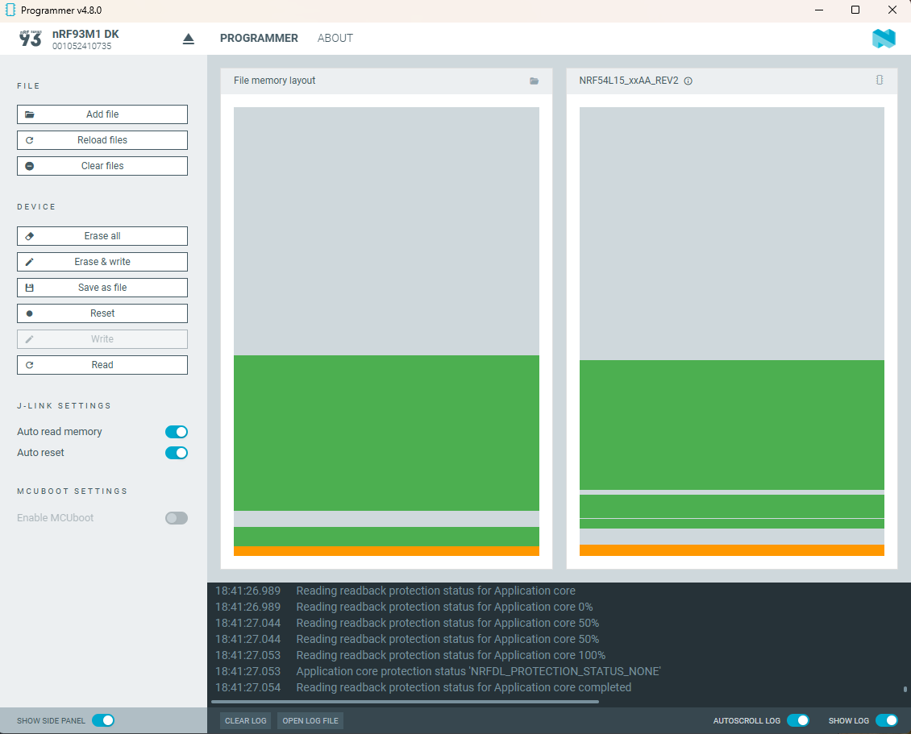

Reset the nRF93M1-DK using the reset button.

## Step 4 — Create the Hardware Version in nRF Cloud

Before the device connects, we need to create a `Hardware Version` in nRF Cloud. This value is used in device communication but must be defined up front, it does not get created automatically the first time the device checks in, so create it now, before moving on.

In the left sidebar, go to `Project Settings`, select `Hardware`, and press `Create Hardware Version`.

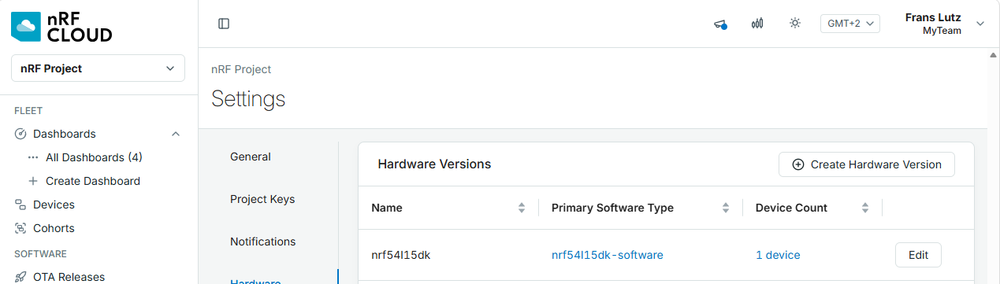

Fill in the following fields exactly:

- Name: `nrf93m1dk`
- Primary Software Type = New → `smha-93m1`

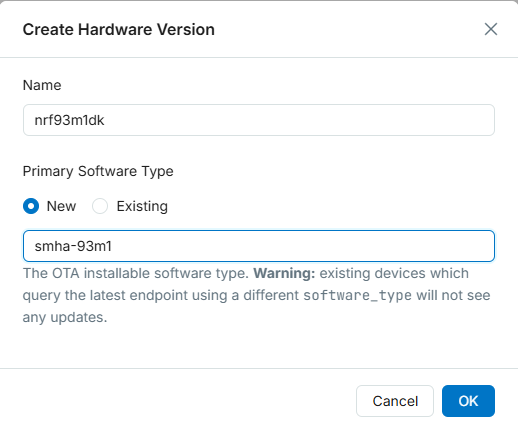

## Step 5 — Get the device ID

Open a serial terminal on the host console (VCOM0). Note the device ID from the boot log: `<inf> nrf_cloud_info: Device ID: <16-hex-device-id>`

This ID comes from the nRF54L15 SoC hardware ID, not the modem UUID. It is shown on the terminal during boot/reset.

```
[00:00:00.037,112] <inf> nrf_cloud_info: Device ID: 316CDxxxxxxxxx82
```

## Step 6 — Create a self-signed CA certificate

Next, we generate our own self-signed Certificate Authority (CA).

We create this CA using `create_ca_cert`, a script from the nRF Cloud Utils package that generates a self-signed Certificate Authority — a private key and certificate used to sign device credentials before onboarding devices to nRF Cloud. You only need to run this once; the same CA can then sign as many device certificates as you need.

Run this in a dedicated folder where you will store the provisioning files:

```
>create_ca_cert -c US -f self_
INFO     Creating self-signed CA certificate...
INFO     File created: c:\temp\work\self_<serial>_ca.pem
INFO     File created: c:\temp\work\self_<serial>_prv.pem
INFO     File created: c:\temp\work\self_<serial>_pub.pem
```

## Step 7 — Install the device credentials

From the same directory as the CA files, where `<serial>` is the value generated in the previous step:

```
device_credentials_installer \
  --ca self_<serial>_ca.pem --ca-key self_<serial>_prv.pem \
  --id-str <device_id> \
  -s -d --verify --coap --local-cert --cmd-type tls_cred_shell \
  --port <serial_port_VCOM0>
```

On Windows, make sure the COM port uses capital letters, e.g. `COMxx`. On a Mac, use `/dev/cu.usbmodem*`.

On success, this writes the file `onboard.csv` locally.

The security tag (sec tag) used is `16842753` — Nordic's reserved default sec tag for nRF Cloud credentials.

## Step 8 — Onboard the device

Onboarding the nRF54L15 application requires the API key from your nRF Cloud account. The API key authenticates *you* — the user or team member acting through the REST API — not the device itself.

Copy this value (the API key): in the Legacy app, open the drop-down menu in the top-right corner, select `User Account`, and copy the `API Key`.

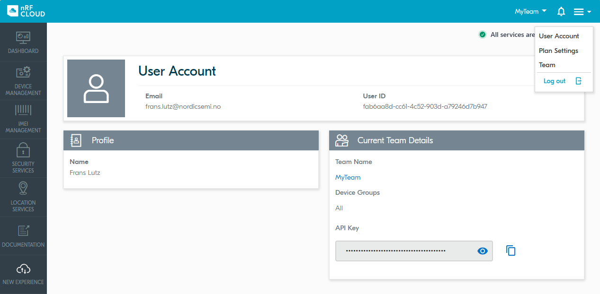

We now call nRF Cloud's onboarding endpoint from your PC, on behalf of your account, to register the device's certificate and ID with your team:

```
nrf_cloud_onboard --api-key <your_api_key> --csv onboard.csv
```

## Step 9 — View the device in nRF Cloud

In nRF Cloud, go to the `Fleet` section under Devices. After a few seconds, the device should be listed there:

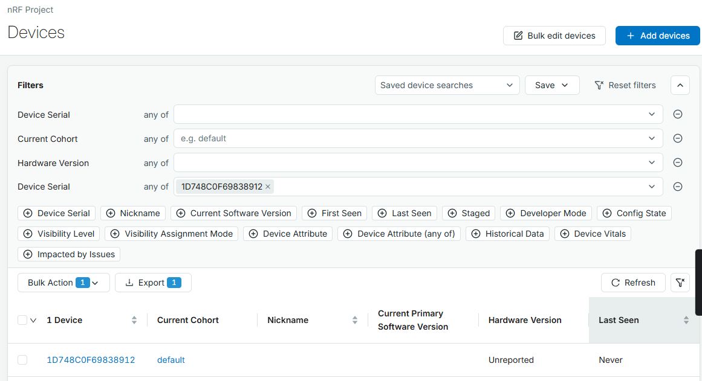

## Step 10 — Insert the SIM card and check the observability data

As noted in Step 1, the nRF93M1-DK ships with an Onomondo SIM card pre-loaded with 10 MB of data (registering the SIM with Onomondo unlocks an additional 40 MB). Now that the device is onboarded, remove the nano/4FF SIM and place it into the SIM card holder on the nRF93M1-DK.

After some time, the application will report observability data to the cloud. You can also trigger this immediately by pressing the reset button.

Press the `reset` button on the nRF93M1-DK and watch the log in the UART terminal. You should see something like this:

```
[00:00:14.836,426] <inf> nrf_cloud_coap_transport: Request authorization with JWT
[00:00:15.018,090] <inf> nrf_cloud_coap_transport: Authorization result_code: 2.01
[00:00:15.018,281] <inf> nrf_cloud_coap_transport: Authorized
[00:00:15.018,299] <inf> nrf_cloud_coap_transport: DTLS CID is active
[00:00:26.447,614] <inf> nrf_cloud_fota_poll: Checking for FOTA job...
[00:00:27.077,980] <inf> nrf_cloud_fota_poll: No pending FOTA job
[00:00:27.078,195] <inf> main: No FOTA update available
```

In the left sidebar, under `DATA INGESTION` → `Processing Log`, you should see at least two events:

1. Received reboot event
2. Received OTA check for update event

Click a row to view its data (`Inspect Payload`).

Pressing button 2 on the DK sends an observability package to the cloud — this is the Memfault-based observability pipeline underneath nRF Cloud's diagnostics. After a few seconds, this package appears in the log. In the `Level` column you will see a warning icon: this is because the symbol file for the build has not been uploaded yet, so Memfault cannot yet decode the payload against your exact firmware build.

To resolve the warning, expand the log message and click the upload button next to the build ID and version. Drag the symbol file from `serial-modem\93m1_ppp_v1\93m1_ppp_v1.elf` into the window.

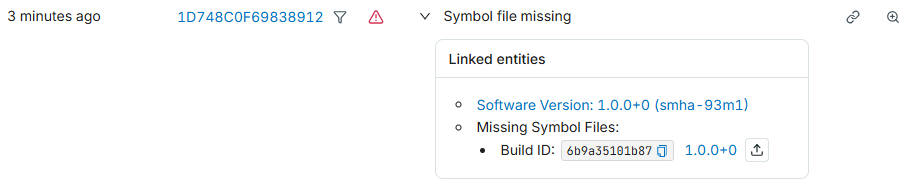

Press button 2 again to send new data. You can view the uploaded data in the `Processing Log`.

Navigate to `Devices` in the left sidebar and click the newly added device. In the `Timeline` tab you will see the uploaded observability data. Set the display time to `Last 24 Hours`; you can also select a smaller time slot by dragging across the timeline with the mouse.

## Step 11 — Update the application firmware (FOTA)

In the left sidebar, go to `OTA Releases`. Click `Create Release`, **set the `Version` field to `2.0.0+0`**, and leave the other fields blank. Click `Create`.

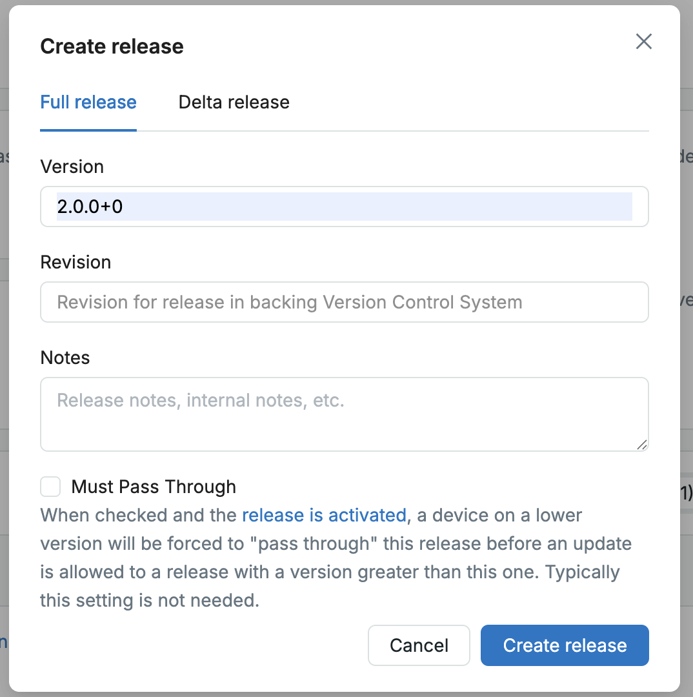

In the next window, click `Add OTA Payload to Release`:

- For `Hardware Version`, select `nrf93m1dk`
- For `Software Type`, select `smha-93m1`
- Upload the file `serial-modem\93m1_ppp_v1\93m1_ppp_v2.signed.bin`

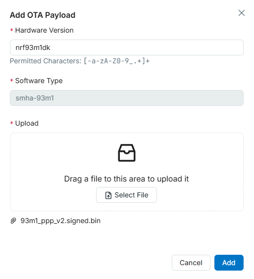

Click `Add` to create the OTA Release.

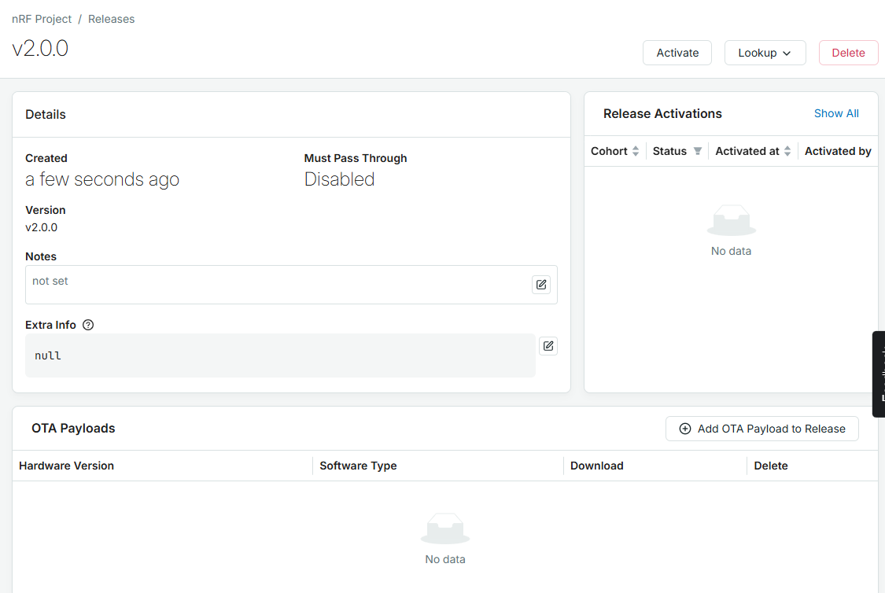**

The last step is to activate the OTA Release by pressing `Activate` within the OTA Release.

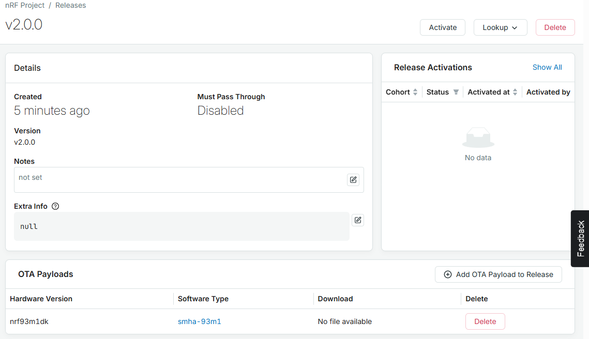

In the next window, select `Cohort` = `Default`.

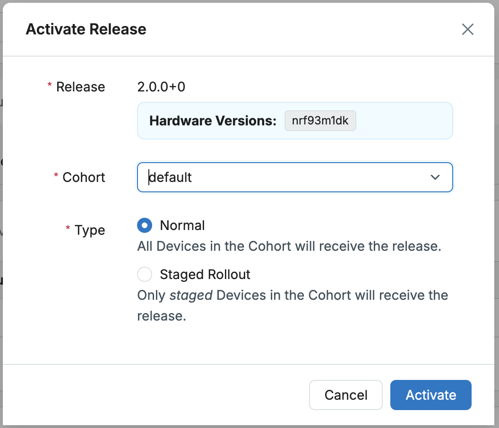

Press button 1 on the nRF93M1-DK to check whether a new firmware version is available. The nRF54L15 should detect the new firmware and start the download. The download size is about 554 KB; progress can be followed in the terminal window.

After the download completes, the nRF54L15 reboots and finishes the firmware update. You can confirm this during boot — the log should show you are now running v2.0.0:

```
[00:00:00.034,521] <inf> main: Serial Modem Host 93m1 starting
[00:00:00.034,539] <inf> main: Version: 2.0.0-dev
```


